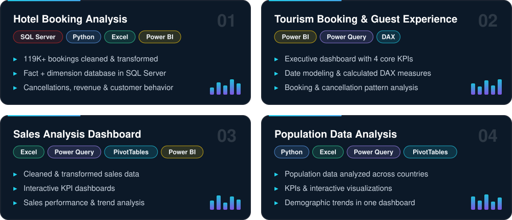
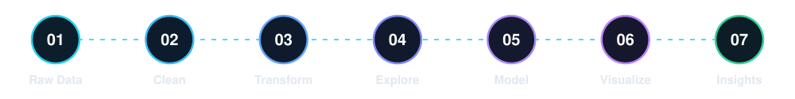

Junior Data Analyst with a <b>B.Sc. in Computer Science</b> from Kafr El-Sheikh University. 
I clean, model and analyze data, then turn it into <b>interactive dashboards</b> that answer real business questions.

&nbsp;&nbsp;
&nbsp;&nbsp;
&nbsp;&nbsp;
&nbsp;&nbsp;
&nbsp;&nbsp;
&nbsp;&nbsp;
&nbsp;&nbsp;
&nbsp;&nbsp;
&nbsp;&nbsp;
&nbsp;&nbsp;
&nbsp;&nbsp;
&nbsp;&nbsp;

